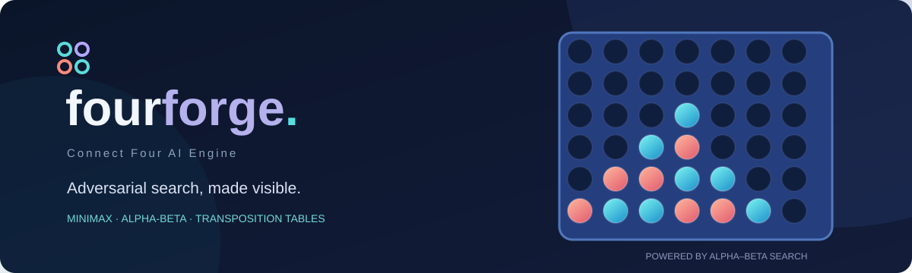

<div align="center">



# FourForge

**A Connect Four game where you can play against an AI and see how it decides what move to make.**

Built with Python and FastAPI · Playable in your browser

</div>

## About the project

I first built Connect Four as a Python terminal game. The computer player used an algorithm called **minimax** to decide which column to play. I later expanded the project into a web app and added several ways to make the computer's search more efficient.

The goal was to build a playable game while also understanding an interesting problem in computer science: **how can a computer choose a good move without checking every possible future move?**

## What you can do

- Play Connect Four against the computer in your browser.
- Choose who goes first and change the difficulty.
- Ask for a suggested move or undo a move.
- Switch between three versions of the AI's search algorithm.
- See how many positions the AI checked, how much work it skipped, and how long it took to decide.

## How the AI chooses a move

The AI doesn't just look at the board and pick a column. It **tries moves in its own simulation** before placing a real chip.

For example, it might simulate placing a chip in column 4. Then it considers how the other player could respond. It continues alternating turns until it has looked a certain number of moves ahead.

At the end of each simulated sequence, the AI gives the resulting board a score. It looks at things like whether either player can win, possible four-in-a-row combinations, and control of the center column. Higher scores are better for the AI; lower scores are better for its opponent.

The AI then works backward through the simulated moves:

- On the computer's turn, it chooses the **highest** score.
- On the opponent's turn, it assumes the opponent will choose the **lowest** score.

This process is called **minimax**. It helps the AI avoid moves that look good at first but allow the opponent to make a strong response.

### How I improved the search

I built three versions to compare:

| Version | How it works |
|---|---|
| **Minimax** | Searches the possible moves to a chosen depth and scores the results. |
| **Alpha-beta pruning** | Uses minimax but stops exploring a path when it can no longer improve the decision. |
| **Optimized alpha-beta** | Also checks promising center columns first and remembers positions it has already searched. |

**Why does skipping moves work?** Say the AI has already found a move worth 3 points. While checking another possible move, it discovers that the opponent can force a result of 2 points. Since the opponent is trying to make the score as low as possible, the AI already knows this new move cannot beat the first one. It can skip the remaining responses for that path.

The optimized version also uses a **transposition table**, which is a cache. If the same board position comes up again during a search, the AI can reuse what it already calculated rather than start over.

These techniques reduce the amount of searching needed. They do not change the underlying minimax score at the same search depth.

## Does the optimized version actually do less work?

I tested the three algorithms on the same three board positions. Each algorithm searched **four moves ahead**.

**The numbers below are board positions the AI examined while deciding on a move, not moves played in the game.** Smaller numbers mean less search work.

| Board being tested | Minimax | Alpha-beta | Optimized alpha-beta |
|---|---:|---:|---:|
| Empty board | 2,801 | 973 | **174** |
| Middle of a game | 2,626 | 1,039 | **303** |
| Position with competing threats | 2,101 | **97** | 257 |

On the empty board, my first minimax version examined **2,801 positions**. The optimized version examined only **174** to get the same minimax score. That's **93.8% fewer positions examined**.

The optimized version isn't always the most efficient. In the third test, regular alpha-beta examined fewer positions. The order in which moves are explored can affect how much pruning is possible.

You can run the comparison yourself:

```bash
python -m engine.benchmarks --depth 4
```

The full saved results are in [`assets/benchmarks.json`](assets/benchmarks.json). Execution times can vary depending on the computer.

## How to run FourForge

You'll need **Python 3.10 or newer**.

**1.** Download the repository and open its folder in VS Code or a terminal.

**2.** Create a Python virtual environment:

```powershell
python -m venv .venv
```

**3.** On Windows, install the required packages and start the game:

```powershell
.\.venv\Scripts\python.exe -m pip install -r requirements.txt
.\.venv\Scripts\python.exe -m uvicorn engine.api:app --reload
```

On macOS or Linux, use:

```bash
source .venv/bin/activate
python -m pip install -r requirements.txt
python -m uvicorn engine.api:app --reload
```

**4.** Go to **http://127.0.0.1:8000** in your browser.

The main website runs directly from the Python server, so you **don't need Node.js**. I also included an optional React and TypeScript version in `frontend/`.

## How to run the tests

From the project folder, install the testing packages and run:

```bash
python -m pip install -r requirements-dev.txt
python -m pytest -q
```

The tests check the rules of Connect Four, winning positions, the AI's decisions, and the connection between the website and Python server.

## Where the code is

| File or folder | What it does |
|---|---|
| `engine/board.py` | Keeps track of the board and checks for legal moves and wins. |
| `engine/search.py` | Contains minimax, alpha-beta pruning, and the improved search. |
| `engine/api.py` | Connects the Python AI to the website. |
| `engine/benchmarks.py` | Measures how much work each algorithm performs. |
| `engine/simulations.py` | Runs games against a random-playing opponent. |
| `web/` | Contains the main playable website. |
| `frontend/` | Contains the optional React/TypeScript interface. |
| `tests/` | Contains the automated tests. |

## What this project demonstrates

FourForge gave me a way to put recursive algorithms into practice, compare different approaches to the same problem, and measure the results rather than just assume an optimization is faster. I also worked on organizing a Python project, building an API, and making an interface that lets other people try the algorithms.

**One limitation:** The AI only looks a set number of moves ahead. It isn't a perfect Connect Four solver, so a human can still beat it.
